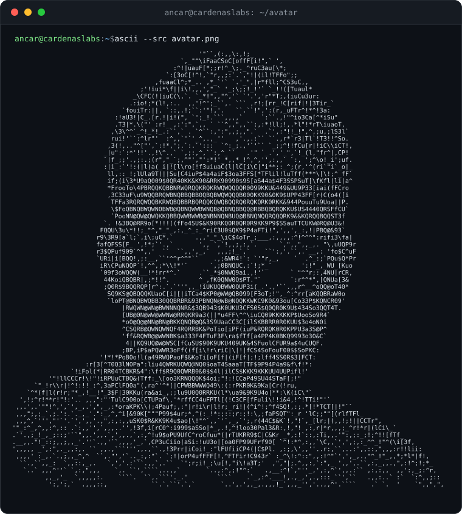

<div align="center">




<br><br>

[](https://cardenaslabs.com/)
[](https://www.linkedin.com/in/andres-cardenas-developer)
[](https://github.com/Ancar2)

</div>

---

<!-- ### `~/about` -->

Soy desarrollador de software enfocado en la construcción de aplicaciones web, soluciones backend y desarrollo de contratos inteligentes.

Trabajo con JavaScript, TypeScript, Angular, Node.js, Express, Java y bases de datos SQL y NoSQL como MySQL y MongoDB, desarrollando aplicaciones Full Stack, APIs REST, sistemas administrativos, integraciones y soluciones digitales.

También me enfoco en el desarrollo de **Smart Contracts con Solidity**, trabajando con aplicaciones descentralizadas (dApps), integración de wallets, interacción con contratos inteligentes y tecnologías Web3. Me interesa llevar la lógica de negocio a entornos descentralizados y conectar los smart contracts con aplicaciones web funcionales.

Utilizo herramientas como Git, GitHub, Bootstrap, Mongoose, Hardhat, OpenZeppelin, Nginx, PM2 y servicios de AWS como EC2, S3 y CloudFront.

Me apasiona aprender, experimentar con nuevas tecnologías y transformar ideas en productos funcionales, buscando construir soluciones eficientes, seguras y escalables.

**Focus:** Full Stack Development · Angular · Node.js · Java · SQL & NoSQL · Smart Contracts · Solidity · Web3 · dApps
---

<!-- ### `~/stack` -->

<div align="center">

**Frontend**


---

**Backend & Databases**


---

**Blockchain & Web3**


---

**Cloud, DevOps & Tools**


</div>

---

### `Projects`

<!-- ```bash
$ ls -la ./featured
``` -->

| Proyecto | Descripción | Stack / Enlaces |
|---|---|---|
| **[TrustPlay](https://dapp.trustplay.app)** | Plataforma Web3 con contratos inteligentes y backend propio. La API tiene repositorio público; el frontend y los contratos son privados. | Solidity · Polygon · Node.js · Express · MongoDB · [API](https://github.com/Ancar2/backend_Trustplay) |
| **[CardenasLabs](https://cardenaslabs.com/)** | Marca personal, portafolio y espacio para desarrollar productos y soluciones tecnológicas. | Angular · Node.js · Express · MongoDB · [API](https://github.com/Ancar2/api_cardenasLABS) |
| **[BiVora](https://github.com/Ancar2/BiVora)** | Plataforma de alquiler de bicicletas con gestión de usuarios, bicicletas, estaciones y alquileres. | Angular · Express · MongoDB · JWT · [Backend](https://github.com/Ancar2/BiVora) · [Frontend](https://github.com/Ancar2/BiVora-Front) |
| **[NoteWiz](https://github.com/Ancar2/NoteWiz)** | Aplicación de notas con autenticación, formularios reactivos y control de sesión. | Angular · Express · MongoDB |
| **NexPOS** | Sistema de punto de venta con gestión de productos, inventario, ventas y operaciones de caja. | Angular · Node.js · Express · MongoDB |
| **BankX** | Diseño de una plataforma fintech de banca digital con servicios financieros e integración Web3. | Fintech · APIs · MySQL · Web3 |
| **[Model portafolio](https://mafeayala.clabs.click)** | Sitio web tipo portafolio para presentar el perfil y el trabajo de una modelo. | Angular · HTML · CSS · TypeScript |
| **[Pokémon Cards](https://github.com/Ancar2/Entregables/tree/main/Pokemon)** | Proyecto frontend para explorar y visualizar tarjetas Pokémon mediante manipulación del DOM e integración con una API externa. | JavaScript · DOM · HTML · CSS |
| **[Loan Simulator](https://github.com/Ancar2/Loan-Simulator)** | Simulador web para realizar cálculos de préstamos. | JavaScript · HTML · CSS |

<div align="center">

**Más proyectos y desarrollos en [cardenaslabs.com](https://cardenaslabs.com/)**

</div>

---

### `Stats`

<div align="center">


</div>

---

### `Contact`

```bash
EmaiOne     ancar.devcode@gmail.com
EmailTwo    ancar@cardenaslabs.com
Web         https://cardenaslabs.com/
LinkedIn    https://www.linkedin.com/in/andres-cardenas-developer
GitHub      https://github.com/Ancar2
```

<div align="center">

```text
> abierto a colaboraciones
> interesado en desarrollo de software, Web3 y creación de productos
```

**Construyamos algo significativo.**

[cardenaslabs.com](https://cardenaslabs.com/)

</div>
